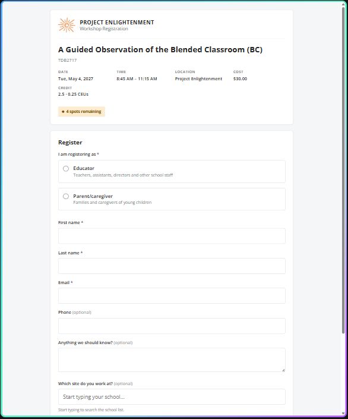
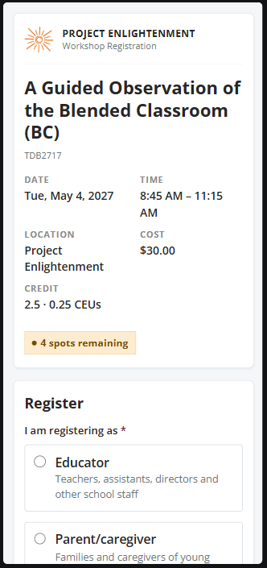
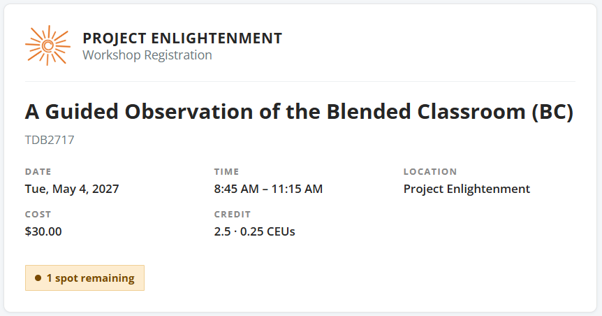
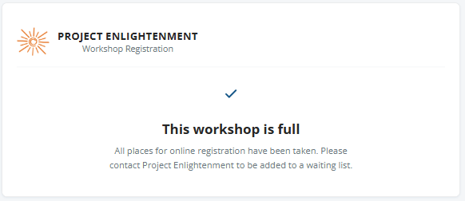
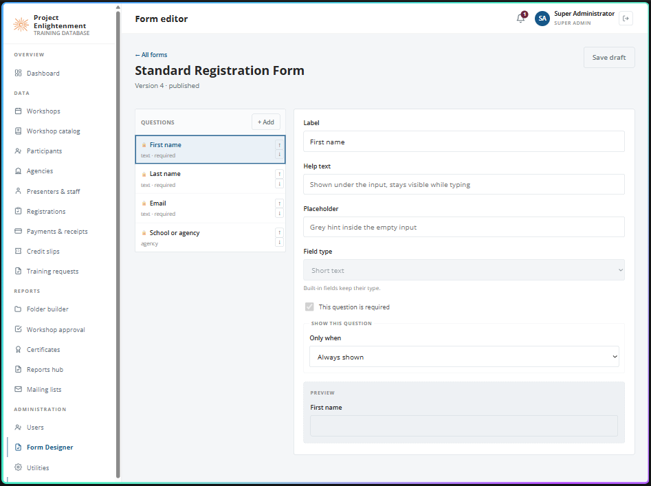
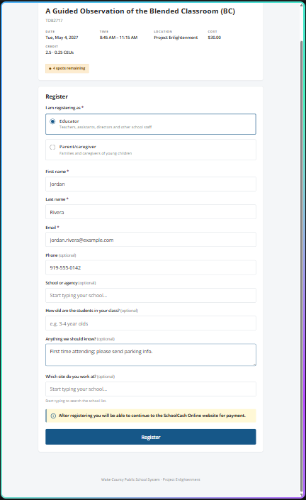
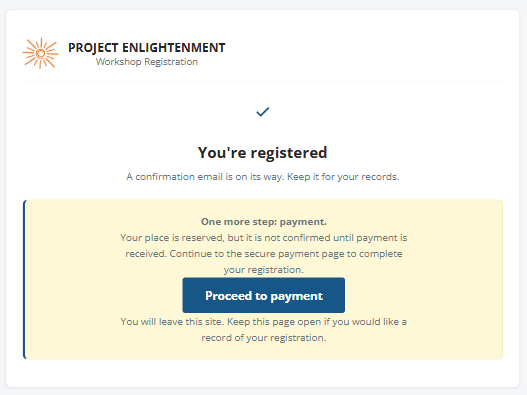
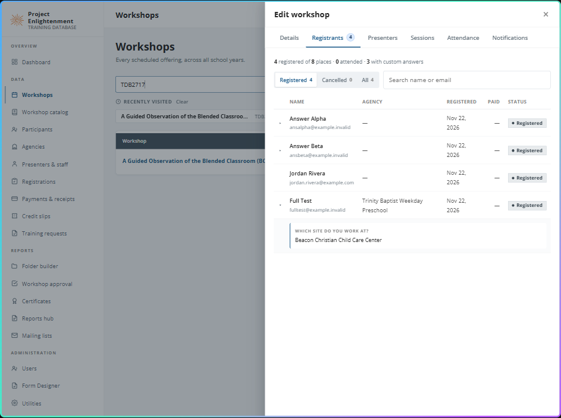
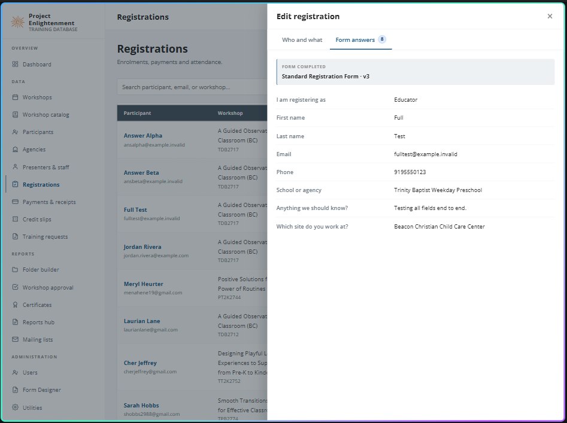

# Project Enlightenment: New Form Solution

**A guide for Project Enlightenment staff**

---

## Why this matters

Families are currently using a Microsoft Form to register for a workshop. That
form is being replaced by the one described here, which they can complete
themselves, at any hour, from a link you send them. This guide walks through
exactly what a family sees from the moment they open the link to the moment
they pay — so you know what to expect, what to tell them on the phone, and
where to find their registration afterwards.

You do not need to configure anything to read this guide. It describes the
finished form, after all the setup is done.

---

## 1. Everything a family needs is at the top

The first thing a family sees is the workshop itself — not a login screen, not
a menu. The title, date, time, location, cost and credit hours are all in one
card, before they are asked for a single piece of information.

This matters for two reasons:

- **Fewer phone calls.** The three questions the office answers most often —
  *when is it, where is it, how much is it* — are answered before the family
  has to ask.
- **No surprises.** Cost and credit hours sit next to the date, so nobody
  registers expecting a free workshop and then meets a payment page.

The form works the same way on a phone, which is how most families will open
the link. There is no sideways scrolling and every field is large enough to
tap comfortably.

---

## 2. Spots remaining update live — and close on their own

Under the workshop details is a live count of the places left. Here the
workshop is nearly full — one place to go:

The number is not a snapshot taken when the page was built. It is worked out
each time the page loads, from the registrations actually on file. When one
family registers, the next family to open the link sees one fewer place.

**When the last place goes, registration closes by itself.** Nobody has to
watch the count or remember to switch the link off. A family who arrives after
the workshop fills sees this instead of a form:

They are told to contact Project Enlightenment about a waiting list, so the
enquiry still reaches you — it just does not become an over-booked workshop.

The same self-closing behaviour covers the two other cases:

| Situation | What the family sees |
|---|---|
| Every place taken | *"This workshop is full"* — with a waiting-list prompt |
| You closed registration | *"Registration is closed"* |
| The link has not opened yet | *"Registration has not opened yet"* |

You can also cap online registration below the room's capacity, so the last
few places stay available for people who call the office. The count respects
that cap.

---

## 3. The questions are yours to change

The questions on the form are not fixed. An administrator can add, remove,
rename and reorder them in the Form Designer, and the public form follows
immediately.

Every question has four parts you can set:

| Setting | What it does |
|---|---|
| **Label** | The question itself, e.g. *"Which site do you work at?"* |
| **Help text** | Guidance shown *under* the field, which stays visible while typing |
| **Placeholder** | A grey hint *inside* the empty field, e.g. *"3-4 year olds"* |
| **Required** | Whether the family must answer before they can submit |

Help text is worth a note. In the old form, guidance was often written as a
placeholder — which vanishes the moment someone starts typing, exactly when
they need it. Help text sits below the field and stays put.

Questions can also be **conditional**. A question can be set to appear only
when an earlier answer calls for it. In the form below, choosing *Educator*
reveals two extra questions that a parent is never shown:

This keeps the form short for everyone. A family only answers what applies to
them, and you only collect answers that mean something.

You can also offer a **school or agency** picker that searches the real school
list, so a family picks from your list rather than typing a name by hand. That
keeps your agency records clean without anyone retyping them.

---

## 4. Payment is handed to SchoolCash Online

When a family submits the form, they are not asked for a card number on our
site. They get a confirmation screen with one clear next step:

The wording is deliberate. **"Your place is reserved, but it is not confirmed
until payment is received."** A family who closes the browser at this point has
a reserved place and an unpaid registration — which is exactly what shows up on
your roster, so you can follow up.

Pressing **Proceed to payment** takes them straight to the SchoolCash Online
page for that workshop. They leave our site and finish there. The note under
the button tells them to keep the page open if they want a record, so nobody
loses their confirmation by navigating away.

If a workshop is free, or you have not attached a payment page, the payment
step is simply not shown and the confirmation screen stands on its own.

---

## 5. You see every registration, with the answers

Registrations arrive in the app the moment they are submitted. Open the
workshop and choose the **Registrants** tab.

At the top you get the summary in one line — *4 registered of 8 places, 0
attended, 3 with custom answers* — followed by the roster: name, email,
school, date registered, amount paid and status.

The **Answers** column is where the custom questions land. The arrow beside a
name opens that person's answers in place, so you can see what they told you
without leaving the roster:

For the full picture, click a name to open the registration. The **Form
answers** tab lists every field the family completed — the standard fields and
the custom ones together, in the order they were asked — with the name and
version of the form they filled in at the top:

That header matters when a form has been revised. It tells you which version
that family actually saw, so an answer that no longer matches the current form
still makes sense.

---

## What staff need to remember

1. **The link is the invitation.** Send the workshop's registration link; the
   form, the details and the payment handoff are all behind it.
2. **You do not need to watch the count.** Registration closes itself when the
   workshop fills.
3. **A reserved place is not a paid place.** Check the roster for registrations
   that stopped at the payment step.
4. **Answers are on the roster and on the registration.** Use the arrow for a
   quick look, the Form answers tab for the full record.
5. **Forms can change without losing history.** Editing a form creates a new
   version; older registrations keep the answers they gave.

---

## Questions this guide does not answer

If a family reports a problem the screens above do not explain — a link that
will not open, a payment that did not go through, a name spelled wrong — treat
it as a data question rather than a form question. Look the registration up
first; the answer is usually on the record.
